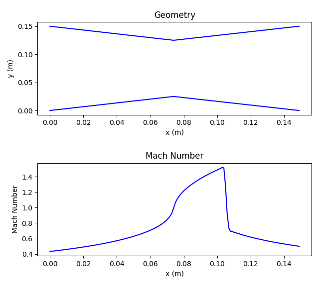
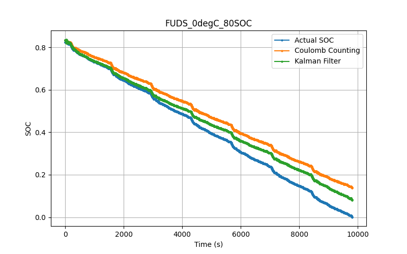

# Modeling 

  

    

    This page looks at some of the modeling projects I have done. These projects were motivated by wanting to learn new mathematical techniques, interest in capturing physical phenomena, and learning how to implement numerical techniques. The projects are not intended to be implemented in any actual engineering application but were for fun to expose myself to new physics, mathematics, and ways of thinking. 
    

    

    The projects found below are:
    

     <ul>
        <li><a href="#CFD">CFD project</a>: 1D CFD tool used to analyze gas flow through a symmetrical pipe</li>
        <li><a href="#kalmanFilter">Kalman filter</a>: Applying the (Extended) Kalman Filter to a Li-Ion state of charge application</li>
        <li><a href="#magnetModel">Magnet Model</a>: Modeling two magnets via magnetic moments and capturing their interactions</li>
     </ul>
    

    Click on a specific project to learn more. Each project has a brief description on what you can find in each one. In each summary section, the heading can be clicked and will open to a more detailed description of each project. 
    

  

---

<!-- # [CFD Project](cfd.html) -->

  <!-- Text content -->
  

    <h1><a href="cfd.html">CFD Project</a></h1>
    

      CFD has always interested me with its combination of physical modeling and numerical integration. With this project, I wanted to see if I could build my own CFD model to test my understanding. Currently, the model is only a 1D model where the user can specify inlet and outlet conditions and enter simple geometries (converging, diverging, converging-diverging). The area is symmetrical along the axial direction. Currently, the model uses ideal gas equations, so it is only valid for fluids that can be modeled as ideal gas.
    

    

      The goal is to eventually expand to 2D, where I can look at more complicated geometries and find the full flow field for the simple geometries used in the 1D model. The current model is written in Python, but C++ will be evaluated for writing the 2D model.
    

    

      This project was an independent exploration of compressible fluid dynamics. The main objectives were to derive the equations, develop a solver, and investigate the behavior (though not in too much depth).
    

  

  <!-- Figure -->
  <figure style="flex: 0 0 50%; min-width: 200px;">
    
    <figcaption style="text-align:center;"><em>Converging-diverging geometry (top) and Mach number results (bottom).</em></figcaption>
  </figure>

---

<!-- # [Kalman Filter Project](kalmanfilter.html) -->

  <!-- Text content -->
  

    <h1><a href="kalmanfilter.html">Kalman Filter</a></h1>
    

      This project was motivated by a conversation with a work colleague where we were discussing how a measurement used in engine control was noisy and the control would end up using the model value instead of the measurement. I came across the Kalman filter on a previous project and this seemed like another application where it could be implemented. 
    

    

      Here, I revisit the Kalman filter and build it out to test my understanding of the filter, its derivation, and any practical challenges in practically implementing the filter. I was mostly interested in learning a little more about the math behind the Kalman filter to better appreciate where it comes from and what it can be used for. This project is not intended to be a perfect or solid engineering application but more of a learning exercise. 
    

    

      I learned a few things about how to better organize this project so hopefully this is a little more clear than the CFD project. Overall, it was cool to experiment with the Kalman filter. It’s clearly a very ingenious idea but it can be challenging to tune (which I get into but don’t explore too too much)
    

  

  <!-- Figure -->
  <figure style="flex: 0 0 50%; min-width: 200px; align-items: center">
    
    <figcaption style="text-align:center;"><em>Kalman Filter Block Diagram.</em></figcaption>
    
    <figcaption style="text-align:center;"><em>Kalman Filter SOC estimation vs Coulomb Counting compared to actual SOC.</em></figcaption>
  </figure>

---

<!-- # [Magnet Model Project](magnetModel.html) -->

  <!-- Text content -->
  

    <h1><a href="magnetmodel.html">Magnet Model</a></h1>
    

    The idea to model two magnets and see if I could capture the physics was inspired by reading
    Volume II of The Feynman Lectures on Physics. I have been meaning to improve my electromagnetic knowledge and I thought it would be cool if I could model two magnetic blocks assuming that each magnet could be represented by a magnetic moment. I know this isn't completely physically representative and that the magnetic dipole derivation is really only appropriate for finding the fields (electric and magnetic) far away from the dipole. I figured if I assumed that the dipole is small and that by considering the fields outside of the magnetic block, I could get away with that. This is basically assuming that the magnet is large enough and the magnet weak enough, that a single magnetic dipole approximation for each magnet is sufficient. 
    

    

    This problem became fairly involved and I re-organized this project and decided to put it on the website. I ended up learning a lot about collision detection and impulse response which doesn't just apply to magnets. I decided my end goal would be to take two magnets, run some basic experiments, and see if I could replicate the results with the model. This project documents this. The video on the right shows two magnets interacting when the blue magnet is held still. The collision detection and impulse response can be seen when the magnets collide. I had to slow the video down to 1% speed which makes sense. If you ever played with magnets, you know how fast they can respond. The arrows show the direction of the magnetic moment. 
    

    

    I think this is probably my most original idea for a modeling project. I know that commercial solvers must exist for magnets but I really don't know much about them. With the CFD and Kalman filter, I knew those would work out since many people have already demonstrated that before me. With this project, it was a bit of a gamble if the model would even work at all. Along the way, I got to learn a little more about collision detection and impulse response. It was fun exploring ways to simplify the physics to better model them. I can really appreciate the balance between capturing too much detail vs not enough, and then creating a solver that doesn't require endless computational power. 
    

  

  <!-- Figure -->
  <figure style="flex: 0 0 50%; width: 60%; margin: 0 auto; align-self: center">
    <video autoplay loop muted playsinline controls style="width:100%; border-radius:5px;">
        <source src="/assets/magnetModel/magnet_video_intro.mp4" type="video/mp4">
    </video>
    <figcaption style="text-align:center;"><em>Magnet interaction with one magnet held still (blue) at 1% of actual speed.</em></figcaption>
  </figure>

