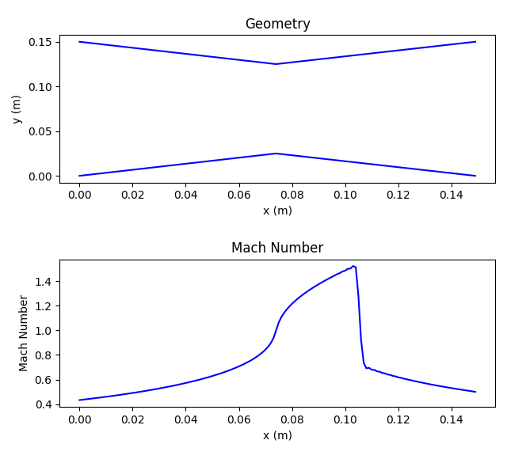

  <!-- Figure -->
  <figure style="flex: 0 0 50%; min-width: 200px;align-self: center">
    <!--  -->
    
    <figcaption style="text-align:center;"><em>Cambridge Half Marathon.</em></figcaption>
  </figure>

  <!-- Text content -->
  

    <h1 style="text-align: center">About Me</h1>
    

      Hi, I’m Tyler — an engineer with interests in math, physics, and modeling. I currently work as a control engineer at GE Aerospace primarily supporting our demonstrator engine programs. 
    

    

      I've had a lot of success in my career due to my ability to be a curious about a problem, ability to conceptualize the problem and identify the relevant physics, and model the situation mathematically. A lot of these skills I learned outside of the classroom and workplace. Soon after the completion of my undergrad degree, I realized I missed learning and took that upon myself to address. This was mostly done through reading math and physics books. I now have a couple lifetimes worth of textbooks in my apartment. 
    

    

      This site is a collection of some of my work, notes, and side projects. These projects are not intended to be complete engineering applications but to demonstrate my curiosity, ability to learn new concepts, and to put some structure behind that. 
    

    

    <!-- Feel free to explore the **Modeling** and **Miscellaneous** sections, or [get in touch](/contact.html). -->
    Feel free to explore the <a href="/modeling/index.html">Modeling</a> and <a href="/miscellaneous/index.html">Miscellaneous</a> sections, or <a href="/contact/index.html">Get in Touch</a>.
    

  

  <!-- Text content -->
  

    <h1 style="text-align: center">More About Me</h1>
    

      I began my engineering career at BlazeTech and the appeal of BlazeTech was that I would be able to work on a variety of projects. I didn't really know what I wanted to do coming out of college. BlazeTech was an amazing opportunity to learn about a variety of topics and I found developed a strong passion for modeling and analysis. I got to improve my design and testing skills too. I don't exactly enjoy design and testing as much as the analysis part but appreciate that engineering comes down to test and how to adjust the design to meet your requirements.  
    

    

      I joined GE in the control system group mainly to learn more about system integration and control seemed like a natural extension of my modeling interest. Before developing any control, you usually need a model. At GE, I learned a lot about system architecture and control theory. I have always prided myself on my range of skills. I am not a master in any specific discipline but I am knowledgeable in a lot of different disciplines. 
    

    

      My greatest strength is that I can see a problem or challenge, identify what needs to be done, identify the skills needed to develop the solution, and then implement that. I thrive in places with a lot uncertainty and like to think of myself as a bridge from theory to application.
    

  

  <!-- Text content -->
  

    <h3 style="text-align: center">AI Disclosure</h3>
    

    I did use AI (Claude) in some of these projects. I think it's important to be upfront about that. I think it's also important to clarify how I use AI in my work. I use AI in three different ways: 
    

    <ol>
    <li>Advanced google:</li>
    

    I've had some luck in using AI to bounce ideas off. The collision detection using the Separate Axis Theorem in my magnet model came from Claude. Claude showed me how that theorem could be the answer to my problem and then I went and learned about that theorem and how to use it on my own. This is susceptible to what Claude thinks is relevant or not, and you have to be careful since sometimes AI just tells you what you want to hear.
    

    <li>Some scripting help:</li>
    

    I am very much against letting AI develop any modeling code without direct involvement from me. If I don't understand the math or the physics being used, I don't use it. I do use AI to help me build scripts to pull data in from an Excel file or to help make my code more robust. In my Magnet Model, Claude helped me build this class function where I can input the magnet properties once and then use that function to pull the properties in rather than having to change the properties in every script. Linear algebra is a little more difficult to use in Python compared to MATLAB and Claude helped me figure out how to write row and column vectors more effectively. All of the actual physics code was written by me, or at least started by me and Claude was used to make it a little more robust to invalid entries.
    

    <li>Proofreading and troubleshooting:</li>
    

    Proofreading and troubleshooting: Claude can be helpful in finding errors much more quickly than I am. However, you need to be careful again since AI can confuse itself. This again happened with the magnet model when Claude was telling me that my quaternion time derivative was wrong but it was actually confused about what was rotating with respect to what. 
    

    </ol>
    

    Just like most things, I don't think AI is inherently good or bad, but it's more about how we use it. I am still working out my own personal feelings and trying to maintain my integrity. For me currently, this is not relying on AI to do any of the math or physics for me. I value learning and knowing math and physics, and can't ever outsource that to AI. I hear stories of people building models at work that they don't understand and this can be very dangerous. I don't think this is necessarily new. MATLAB has a lot of built in functions that I see people misuse. Also I'm sure there are people out there who use CFD packages but don't necessarily understand where the conservation equations come from. I do find some value in AI helping me structure and organize myself better. I'm not a software architect expert (far from it) and AI has helped me organize my projects better. However I constantly have to ask myself am I learning anything from this or is the AI doing it for me?
    

  

