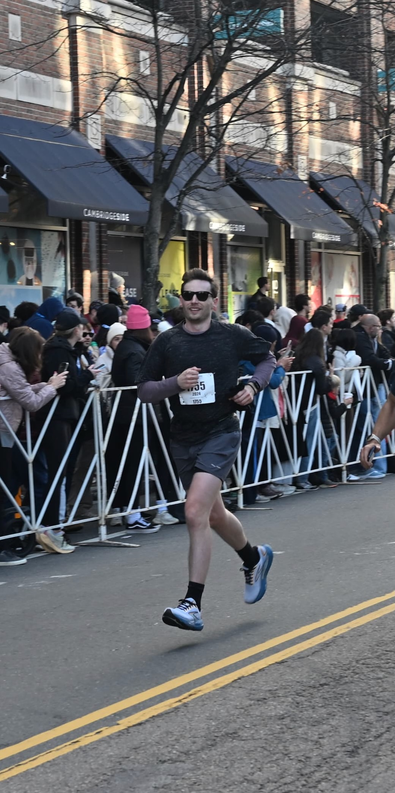

  <!-- Figure -->
  <figure style="flex: 0 0 50%; min-width: 200px;align-self: center">
    <!--  -->
    
    <figcaption style="text-align:center;"><em>Cambridge Half Marathon.</em></figcaption>
  </figure>

  <!-- Text content -->
  

    <h1 style="text-align: center">About Me</h1>
    

      Hi, I’m Tyler — an engineer with interests in math, physics, and modeling. I currently work as a control engineer at GE Aerospace primarily supporting our demonstrator engine programs. 
    

    

      I've had a lot of success in my career due to my ability to be curious about a problem, conceptualize the problem and identify the relevant physics, and model the situation mathematically. A lot of these skills I learned outside of the classroom and workplace. Soon after the completion of my undergrad degree, I realized I missed learning and took that upon myself to address. This was mostly done through reading math and physics books. I now have a couple lifetimes worth of textbooks in my apartment. 
    

    

      This site is a collection of some of my work, notes, and side projects. These projects are not intended to be complete engineering applications but to demonstrate my curiosity, ability to learn new concepts, and to put some structure behind that. 
    

    

    <!-- Feel free to explore the **Modeling** and **Miscellaneous** sections, or [get in touch](/contact.html). -->
    Feel free to explore the <a href="/modeling/index.html">Modeling</a> and <a href="/miscellaneous/index.html">Miscellaneous</a> sections, or <a href="/contact/index.html">Get in Touch</a>.
    

  

  <!-- Text content -->
  

    <h1 style="text-align: center">More About Me</h1>
    

      I began my engineering career at BlazeTech and the appeal of BlazeTech was that I would be able to work on a variety of projects. I didn't really know what I wanted to do coming out of college. BlazeTech was an amazing opportunity to learn about a variety of topics and I developed a strong passion for modeling and analysis. I got to improve my design and testing skills too. I enjoy analysis work the most, but value and appreciate that everything comes down to test. At BlazeTech, I used my analysis skills to identify what rotational speeds we needed to test our spin filter at to see the efficiencies we were targeting. I then worked with the team to make our filter design supported running at those speeds. Instead of learning all this on test, I could anticipate some of the challenges through analysis work. Through my strong analysis skills and understanding the importance of test, I create a strong connection between what we model and analyze, and how to test component and systems. 
    

    

      I joined GE in the control system group mainly to learn more about system integration and control seemed like a natural extension of my modeling interest. Before developing any control, you usually need a model. At GE, I learned a lot about system architecture and control theory. I have always prided myself on my range of skills. My depth is in phsyics-based modeling of thermo-fluid dynamics, and I extended this to control theory through GE. I am also very comfortable working in disciplines around this including performance and combustion. When evaluating and designing a control system, it is extremely important to understand the plant. In our current projects at GE, fluid dynamics are more part of the control loop then before, and I have carved out a space between the fluids and control system disciplines. I use my modeling background to ensure that our control system models include all relevant physics, and I use my control background to ensure that the system architecture doesn't require too complex control system solutions. 
    

    

      My greatest strength is that I can see a problem or challenge, identify what needs to be done, identify the skills needed to develop the solution, and then implement that. I thrive in places with a lot of uncertainty and like to think of myself as a bridge from theory to application.
    

  

  <!-- Text content -->
  

    <h3 style="text-align: center">AI Disclosure</h3>
    

    I used AI (Claude) on some of these projects, and I want to be upfront about how.
    

    <ol>
    <li>Brainstorming:</li>
    

    Claude suggested the Separating Axis Theorem for collision detection in my magnet model. I then learned the theorem and implemented it myself. It can only suggest what it thinks is relevant, and sometimes it just tells you what you want to hear.
    

    <li>Scripting help:</li>
    

    Claude helped with importing Excel data, input validation, a class that stores the magnet properties in one place, and handling row and column vectors in Python. The physics code is mine. Claude helped make it more robust.
    

    <li>Proofreading and troubleshooting:</li>
    

    Claude finds errors faster than I can, but it can confuse itself. It once flagged my quaternion time derivative as wrong because it misread which frame was rotating. 
    

    </ol>
    

    AI isn't inherently good or bad, and any tool, AI or commercial software, can be misused when you don't understand it. My rule is that the math and physics are always mine. If I can't derive and explain it, I don't use it.
    

  

